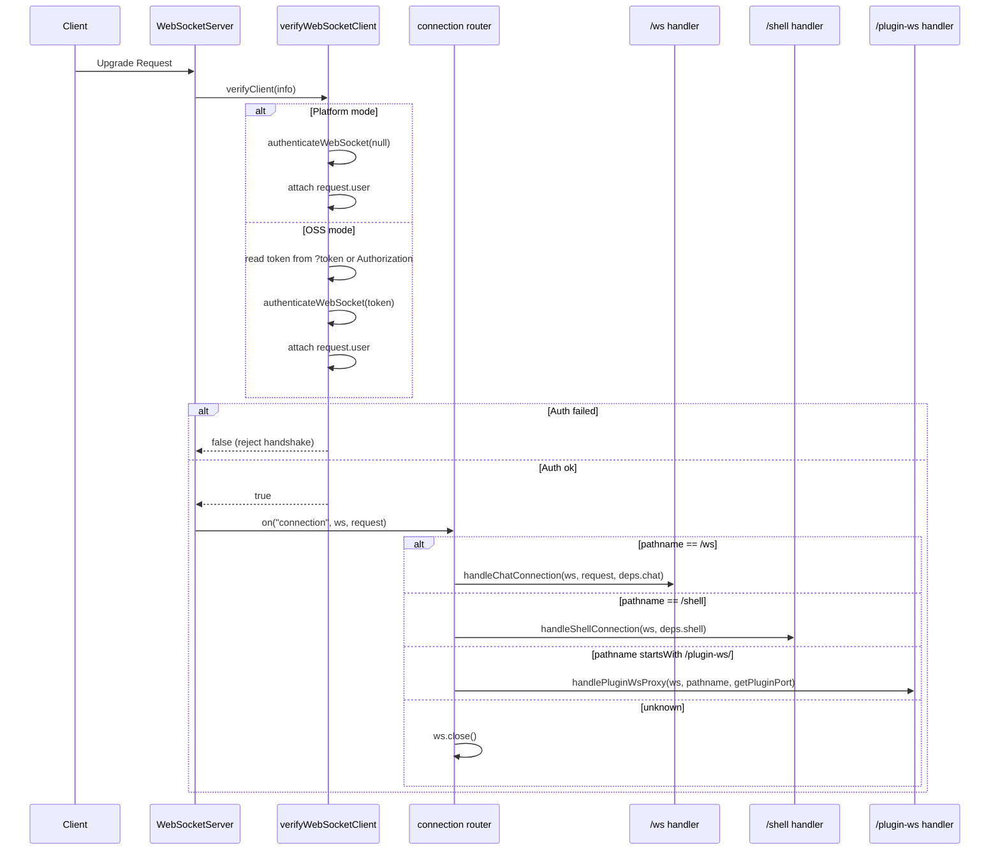
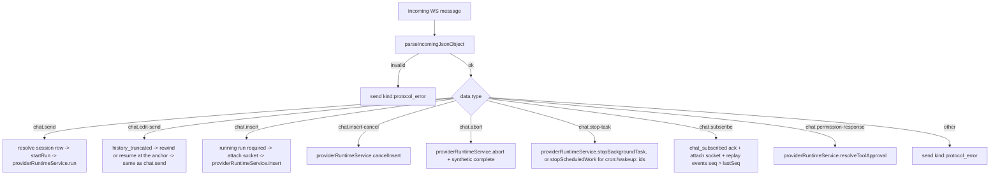
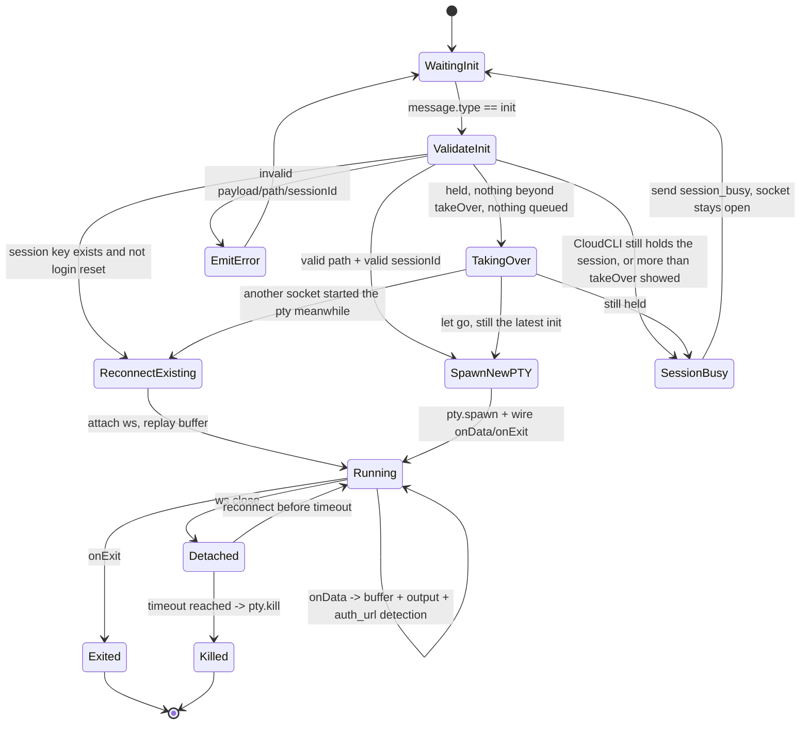
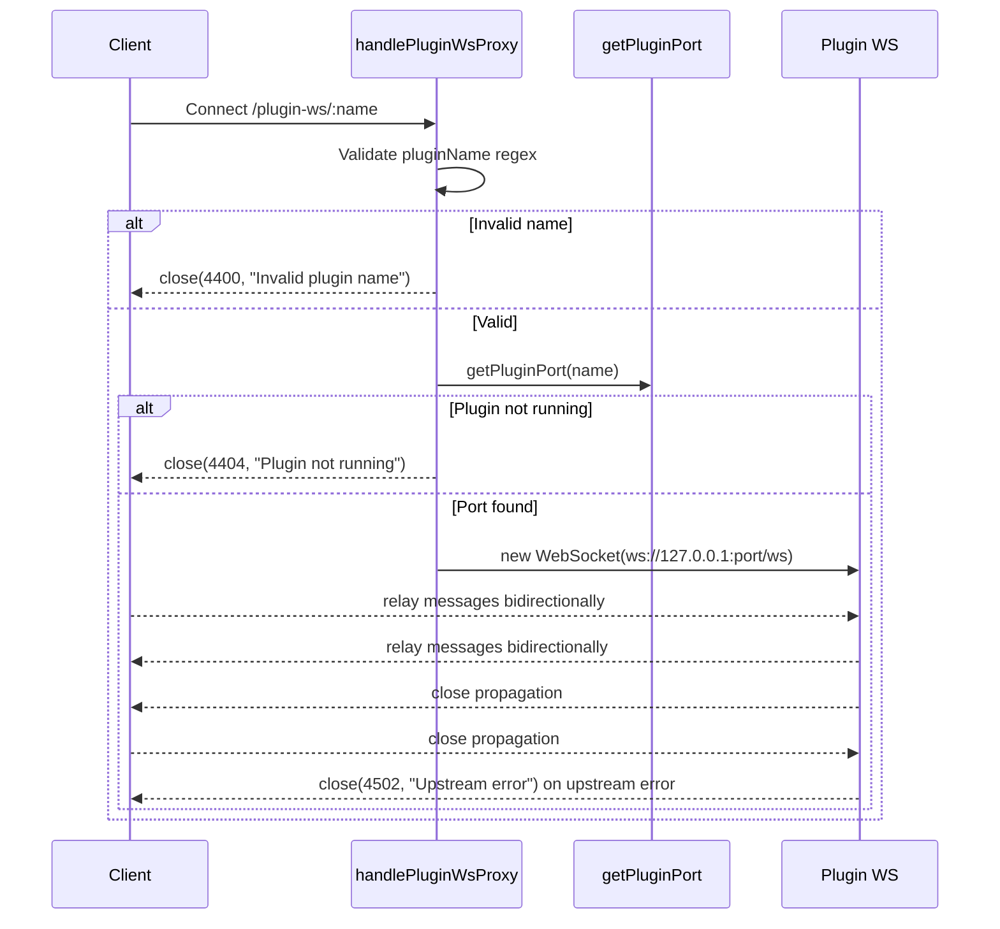

# WebSocket Module

This module owns the server-side WebSocket gateway used by:

1. Chat streaming (`/ws`)
2. Interactive terminal sessions (`/shell`)
3. Plugin WebSocket passthrough (`/plugin-ws/:pluginName`)

It is intentionally structured as **small services** plus a **barrel export** in `index.ts`.

## Public API

`server/modules/websocket/index.ts` exports:

1. `createWebSocketServer(server, dependencies)`  
Creates and wires the shared `ws` server.
2. `connectedClients` and `WS_OPEN_STATE`  
Shared chat client registry and open-state constant used by other modules.

## Why Dependency Injection Is Used

The module receives runtime-specific functions from `server/index.ts` instead of importing legacy runtime files directly.

Benefits:

1. Keeps module boundaries clean (`server/modules/*` architecture rule).
2. Makes each service easier to test in isolation.
3. Keeps WebSocket transport concerns separate from provider runtime concerns.

## Service Map

| File | Responsibility |
|---|---|
| `services/websocket-server.service.ts` | Creates `WebSocketServer`, binds `verifyClient`, routes connection by pathname |
| `services/websocket-auth.service.ts` | Authenticates upgrade requests and attaches `request.user` |
| `services/chat-websocket.service.ts` | Handles the `/ws` chat protocol (`chat.send` / `chat.edit-send` / `chat.insert` / `chat.insert-cancel` / `chat.abort` / `chat.stop-task` / `chat.subscribe` / `chat.permission-response`) |
| `services/chat-run-registry.service.ts` | Tracks live provider runs per app session id: seq numbering, event replay buffer, provider-id mapping, completion state |
| `services/chat-session-writer.service.ts` | Gateway writer handed to provider runtimes: remaps provider session ids to app ids, swallows `session_created`, assigns `seq` |
| `services/shell-websocket.service.ts` | Handles `/shell` PTY lifecycle, reconnect buffering, auth URL detection, holding a CLI back while CloudCLI still runs the session |
| `services/plugin-websocket-proxy.service.ts` | Bridges client socket to plugin socket |
| `services/websocket-writer.service.ts` | Adapts raw WebSocket to writer interface (`send`, `setSessionId`, `getSessionId`) for non-chat writer consumers |
| `services/websocket-state.service.ts` | Holds shared chat client set and open-state constant |

## High-Level Architecture

```mermaid
flowchart LR
  A[HTTP Server] --> B[createWebSocketServer]
  B --> C[verifyWebSocketClient]
  B --> D{Pathname}
  D -->|/ws| E[handleChatConnection]
  D -->|/shell| F[handleShellConnection]
  D -->|/plugin-ws/:name| G[handlePluginWsProxy]
  D -->|other| H[close()]

  E --> I[connectedClients Set]
  E --> J[chatRunRegistry + ChatSessionWriter]
  F --> K[ptySessionsMap]
  G --> L[Upstream Plugin ws://127.0.0.1:port/ws]

  I --> M[projects.service loading_progress]
  I --> N[sessions-watcher.service session_upserted]
```

## Connection Handshake + Routing



## `/ws` Chat Flow

When a chat socket connects:

1. Add socket to `connectedClients`.
2. Parse each incoming message with `parseIncomingJsonObject`.
3. Dispatch by `data.type` (eight message types, none provider-specific).
4. On close, remove socket from `connectedClients`.

### Session identity model

The frontend only ever knows the **app session id** (allocated by
`POST /api/providers/sessions` or discovered via the session index). The
provider-native id (JSONL file name, CLI resume id) stays inside the backend:

1. `chat.send` resolves the app id to `{ provider, project_path }` from the sessions DB and passes the **app session id** to the provider runtime.
2. The provider runtime resolves the provider-native id from the sessions DB itself (`sessionsService.resolveProviderSessionId`) at the exact points its CLI/SDK needs it (resume flags, provider-owned databases). Runtimes key their process maps by the app session id, so abort and pending-approval lookups use app ids too.
3. The `ChatSessionWriter` remaps every outbound event back to the app id, and turns `session_created` announcements into a DB mapping update instead of forwarding them.

### Chat Message Dispatch



### Chat Notes

1. **Unified envelope**: every server-to-client frame carries a `kind` — either a provider `NormalizedMessage` kind or a gateway kind (`chat_subscribed`, `session_upserted`, `loading_progress`, `protocol_error`). There is no second `type`-based protocol.
2. **Unified terminal lifecycle**: every provider run ends with exactly one `complete` message built by `createCompleteMessage()` (`server/shared/utils.ts`): `{ kind: "complete", sessionId, actualSessionId, exitCode, success, aborted }`. The chat handler emits a synthetic `complete` for runs that crash or get aborted, and the run registry drops duplicate completes.
3. **Per-run event log**: every live event gets a monotonically increasing `seq`. `chat.subscribe { sessions: [{ sessionId, lastSeq }] }` re-attaches the live stream to the requesting socket (any provider, not just Claude) and replays events with `seq > lastSeq`. If the buffer no longer covers `lastSeq`, the client refreshes over REST.
4. `chat_subscribed` includes `isProcessing` (replaces `check-session-status`) and `pendingPermissions` (replaces `get-pending-permissions`).
5. **Mid-run inserts**: the runtime reports an accepted `chat.insert` as `insert_status` frames through the run's writer (sequenced, replayed). A refused insert (`NO_ACTIVE_RUN`, `UNSUPPORTED`, `SLASH_COMMAND`, `INVALID`) and a failed withdrawal (`cancel_failed`) go back to the asking socket only, without `seq`, and never as `protocol_error`.
6. **Keeping background work**: a `chat.send` with `options.keepBackgroundWork: true` is not started when the session's process is held for background work and the turn cannot go into it (`providerRuntimeService.planHandOver`; the same plan is `POST /api/providers/sessions/:sessionId/hand-over-plan`). The asking socket gets `{ kind: "send_refused", sessionId, reason: "BACKGROUND_WORK_WOULD_STOP", changes, clientRequestId? }` the way insert refusals go. `clientRequestId` is the one the `chat.send` carried (letters, digits, `_`, `-`, at most 128), left out when it had none: every pane of a page shares the socket, and the id names the send the refusal answers. Without the flag the send starts as before and the work stops.
7. **Aborts**: `chatRunRegistry.abortRun` marks the run before it calls the runtime and always sends the aborted `complete` itself; the dispatch safety net holds off meanwhile, so a turn whose promise settles before the abort returns still ends as `aborted`. When the session still has background work once the turn is stopped (the stop ended only a turn handed to the process held for that work), the aborted `complete` carries `backgroundWork: true`, and so does its `run_ended`; the client keeps the session as background work instead of idle.
8. **Stopping scheduled work**: a `chat.stop-task` whose `taskId` starts with `cron:` or `wakeup:` (a /loop's job or wake-up, see `ScheduledWorkSummary`), or with `allScheduled: true`, is answered with `{ kind: "stop_task_status", sessionId, taskId, status, stillHeld?, clientRequestId?, timestamp }` frames, to the asking socket only, without `seq`, never as `protocol_error`; `clientRequestId` is the stop's own, as for `send_refused`. A turn under way gets `busy`. Otherwise `providerRuntimeService.stopScheduledWork` either lets go of the held process (`stopped`), names nothing (`not_found`), is still in its first turn (`busy`), or asks for a turn that has the model cancel the work. That turn is planned like a dispatcher message (`inheritUnset`): when it would need a new process while the held one runs other work it is not started (`failed`); else it runs detached as the asking user (`started`, or `busy` when a run got in first), with the asking socket attached to it, and once its `complete` is out, `finished` says with `stillHeld` whether any of the targeted work is still listed.
9. **Work past the turn**: a session's run stays attachable (`chat.subscribe`) and registered (the retention guard `server/index.ts` installs) while the runtimes hold background tasks or scheduled work for it (`holdsWorkPastTurn`), so the turn's `run_ended` says `backgroundWork: true` for a turn that set up a /loop too. When a later turn goes into that held process (`reportProcessHandedOver`), the run it leaves hands its open sockets to the run of that turn, which the process writes through from then on: tabs that watched the process keep hearing its firings and permission requests.
10. **Switches for one turn**: every turn records its model, effort and ultracode on the session row before it runs (the runtime resolves a resumed turn's model from it). A turn whose options set `restoreSwitchesAfterTurn` (a queued or due message) also gets an `onSwitchesRestored` run option from the gateway: once the runtime reports the turn over, its held process staying and switched back (also when the turn was stopped before it switched anything), each value recorded before the turn goes back, unless the user picked another meanwhile, so a composer opened later neither switches the /loop to the message's model nor asks for a new process over an effort or ultracode the message ran without (`acceptProcessSettings`). When a second such turn went before the first one's switch-back came, the record is the second one's, and only its switch-back puts that value back: the one recorded before the first, or the one the user picked while the first ran.
11. **Turns on the held process's settings**: only the scheduled-messages dispatcher sets `acceptProcessSettings`. `buildTurnRunOptions` drops it from a client's options (`chat.send`, `chat.edit-send`, the hand-over plan), and `runDetachedChatTurn` passes it on once the dispatcher's plan with it lets the turn into a process held only for scheduled work. Tool rules stricter than the process's still keep the turn out, and the run is handed over as planned. A turn the process does not take after all fails instead of starting a new process: its run gets `{ kind: "error", code: "HAND_OVER_FAILED", reason, content }` (`reason`: `stale-plan` or `lookup`; `content` in English), `runDetachedChatTurn` tells its caller (`onHandOverFailed`), and the dispatcher puts a queued message back in the queue, to be tried again after a wait that doubles from 30 s up to 10 minutes while the process keeps turning it away, or marks a due one failed with `hand_over_failed:stale-plan` or `hand_over_failed:lookup` (another reason keeps the English text).

## `/shell` Terminal Flow

The shell handler manages persistent PTY sessions keyed by:

`<projectPath>_<sessionIdOrDefault>[_cmd_<hash>]`

This enables reconnect behavior and isolates command-specific plain-shell sessions.

### Shell Lifecycle



### Shell Behaviors in Detail

1. `init`:
Reads `projectPath`, `sessionId`, `provider`, `hasSession`, `initialCommand`, `isPlainShell`, `forceRestart`, `takeOver`, `initId`.
2. Login reset:
For login-like commands, existing keyed PTY session is killed and recreated.
3. Validation:
Path must exist and be a directory; `sessionId` must match safe pattern.
4. Session check:
A provider CLI is not started on a session CloudCLI itself still holds: a chat turn under way (any provider), a Claude process held for background work or still exiting, or a queued chat message. The socket gets `{ type: "session_busy", sessionId, provider, reason, tasks, scheduled, turnStartedAt, hasQueuedMessage, changed, initId }` (`reason`: `turn`, `exiting`, `background`, `held` or `queued`; `scheduled`: the scheduled work the process holds, always sent; `turnStartedAt`: the running turn's `startedAt`, or null; `initId`: the answered init's, when it sent one) and stays open for another `init`. `takeOver` is `{ turnStartedAt, taskIds, scheduledIds? }` from the last `session_busy`, every task id included. With no queued message, the handler compares it with what it has just read: a running turn with another `startedAt`, a task whose id it lacks, or, when the snapshot has `scheduledIds`, scheduled work whose id it lacks, stops nothing and gets a fresh `session_busy` with `changed: true`. Otherwise it aborts the turn and has the runtimes let go of the session (waiting for the process to exit), then checks again. A bare `takeOver: true` (a page loaded before the snapshot) counts as an empty snapshot. Plain shells, sessionless launches and reconnects to a running PTY are never held back. A restart still kills the old PTY.
5. Command build:
Provider-specific command construction with resume semantics.
6. PTY output buffering:
Stores up to 5000 chunks for replay on reconnect.
7. URL detection:
Strips ANSI, accumulates text buffer, extracts URLs, emits `auth_url` once per normalized URL, supports `autoOpen`.
8. Close behavior:
Socket disconnect does not instantly kill PTY; session is kept alive and terminated on timeout.

## `/plugin-ws/:pluginName` Proxy Flow



## Shared Client Registry and Broadcasts

Only chat sockets (`/ws`) are tracked in `connectedClients`.

That shared set is consumed by:

1. `modules/projects/services/projects-with-sessions-fetch.service.ts`
Broadcasts `kind: loading_progress` while project snapshots are being built.
2. `modules/providers/services/sessions-watcher.service.ts`
Broadcasts per-session `kind: session_upserted` deltas when provider session artifacts change (no full project snapshots).

This design centralizes cross-module realtime fanout without requiring route-local references to WebSocket internals.

## Writer Adapter (`WebSocketWriter`)

`WebSocketWriter` normalizes chat transport behavior to match existing writer-style interfaces used elsewhere.

Methods:

1. `send(data)`  
JSON-serializes and sends only if socket is open.
2. `setSessionId(sessionId)` / `getSessionId()`  
Supports provider session bookkeeping and resume flows.
3. `updateWebSocket(newRawWs)`  
Allows active session stream redirection on reconnect.

## Error Handling and Close Codes

Current explicit close codes in this module:

1. `4400`: Invalid plugin name
2. `4404`: Plugin not running
3. `4502`: Upstream plugin WebSocket error

Other errors:

1. Chat handler catches and emits `{ kind: "protocol_error", code, error }`.
2. Shell handler catches and writes terminal-visible error output.
3. Unknown websocket paths are closed immediately.

## Extending This Module

To add a new websocket route:

1. Add a new handler service under `services/`.
2. Extend `WebSocketServerDependencies` in `websocket-server.service.ts` if needed.
3. Add a new pathname branch in the router.
4. Wire dependency injection from `server/index.ts`.
5. Keep `index.ts` as barrel-only export surface.
